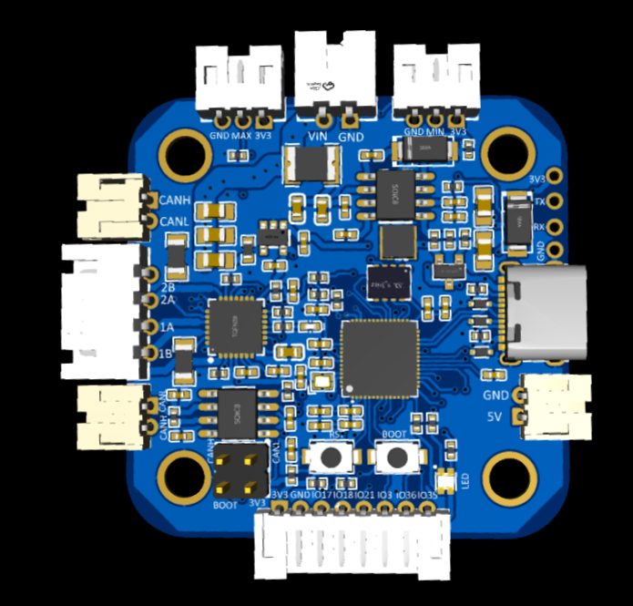
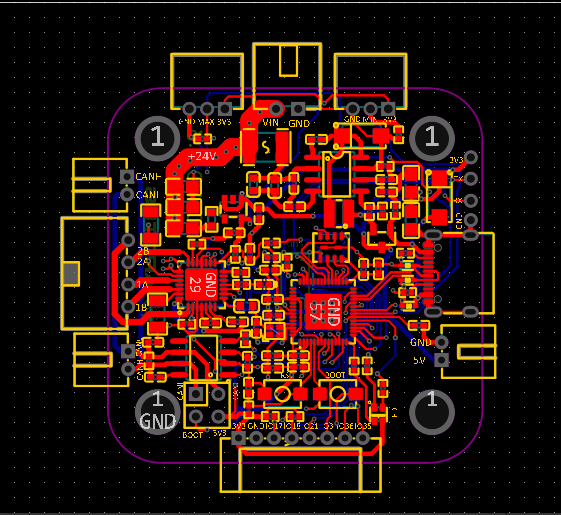
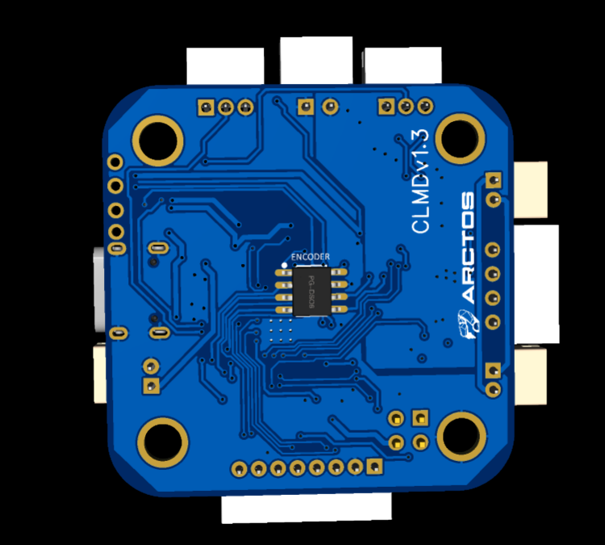

# Open Source Closed-Loop Stepper Motor Driver

[](https://opensource.org/licenses/MIT)
[]()
[](https://github.com/espressif/esp-idf)

A complete open-source closed-loop stepper motor control system featuring ESP32-S3 firmware, TMC2209 silent stepper driver, TLE5012B magnetic encoder, and a sophisticated PyQt5 configuration tool. Designed for precision robotics applications including 6-axis robotic arms.



## 🎯 Key Features

### Hardware
- **ESP32-S3R8** dual-core MCU with 8MB PSRAM
- **TMC2209** silent stepper driver (up to 2A RMS, StealthChop2)
- **TLE5012B** 15-bit magnetic encoder (0.011° resolution)
- **CAN Bus** communication (500 kbps, daisy-chain topology)
- **USB Type-C** for configuration and firmware updates
- **Limit switches** (J_MIN/J_MAX) for homing and safety
- **RGB LED** for status indication
- **Wide input voltage**: 6-28V DC (optimized for 12-24V)

### Firmware
- **1 kHz closed-loop control** with PID algorithm
- **Trapezoidal motion planning** for smooth acceleration/deceleration
- **CAN bus protocol** (MKS-compatible) for multi-axis coordination
- **USB-CDC interface** for real-time configuration
- **Safety features**: position limits, watchdog, error detection
- **NVS flash storage** for persistent configuration
- **FreeRTOS** multi-core task architecture

### Configuration Tool
- **Modern PyQt5 GUI** with dark theme
- **Real-time visualization** of motor position and status
- **Interactive PID tuning** with live plotting
- **RGB LED control** with color preview
- **Endstop monitoring** and encoder diagnostics
- **Firmware upload** directly from GUI
- **TMC2209 diagnostics** including temperature and CoolStep

## 📦 What's Included

```
├── hardware/              # PCB design files, schematics, BOM
├── firmware/              # ESP-IDF firmware source code
├── software/              # PyQt5 configuration tool
├── docs/                  # Documentation and guides
└── release/               # Pre-built binaries and executables
```

## 🚀 Quick Start

### 1. Hardware Setup
1. Review the [Hardware Documentation](docs/hardware_description.md)
2. Order PCBs using the provided Gerber files
3. Assemble components according to the BOM
4. Connect power (12-24V), motor, and encoder

### 2. Firmware Upload
```bash
# Option A: Using the GUI tool (easiest)
cd software
python main.py
# Go to "Firmware Upload" tab and click "Upload"

# Option B: Using ESP-IDF
cd firmware
idf.py set-target esp32s3
idf.py build
idf.py -p COM3 flash
```

See [Firmware Build Guide](docs/HOW_TO_BUILD_FIRMWARE.md) for detailed instructions.

### 3. Configuration Tool
```bash
cd software
pip install -r requirements.txt
python main.py
```

See [Configuration Tool Guide](software/README.md) for usage instructions.

## 📊 Performance Specifications

| Parameter | Value |
|-----------|-------|
| Control Loop Rate | 1 kHz (1ms cycle time) |
| Position Resolution | 0.011° (15-bit encoder) |
| Max Speed | 600 RPM (default, configurable to 1000 RPM) |
| Max Acceleration | 500 deg/s² (configurable) |
| Position Accuracy | ±0.1° (typical, with tuned PID) |
| Motor Current | Up to 2A RMS |
| CAN Bus Speed | 500 kbps |
| USB CDC Baud Rate | 115200 |

## 🏗️ System Architecture

```
PC/Controller → USB-to-CAN Adapter → CAN Bus (500 kbps)
                                        ↓
                    Driver 1 (ID=0x01) ←→ CAN Bus
                    Driver 2 (ID=0x02) ←→ CAN Bus
                    Driver 3 (ID=0x03) ←→ CAN Bus
                    Driver 4 (ID=0x04) ←→ CAN Bus
                    Driver 5 (ID=0x05) ←→ CAN Bus
                    Driver 6 (ID=0x06) ←→ CAN Bus
```

Each driver can be configured independently via USB or controlled simultaneously via CAN bus for coordinated multi-axis motion.

## 📖 Documentation

### Getting Started
- [Quick Start Guide](docs/QUICK_START.md) - Get up and running in 15 minutes
- [Hardware Description](docs/hardware_description.md) - Complete hardware specifications
- [Firmware Architecture](docs/firmware_architecture.md) - Detailed firmware design

### Building & Flashing
- [How to Build Firmware](docs/HOW_TO_BUILD_FIRMWARE.md) - Step-by-step build instructions
- [Install ESP-IDF](docs/INSTALL_ESP_IDF.md) - ESP-IDF setup guide
- [Windows Build Guide](docs/WINDOWS_BUILD_GUIDE.md) - Windows-specific instructions

### Using the System
- [Configuration Tool Guide](software/README.md) - GUI application usage
- [Firmware Upload Guide](docs/FIRMWARE_UPLOAD_GUIDE.md) - Flashing firmware
- [End User Guide](docs/END_USER_GUIDE.md) - Complete user manual

### Advanced Topics
- [PID Tuning Guide](docs/PID_TUNING.md) - Optimize control performance
- [CAN Protocol Specification](docs/CAN_PROTOCOL.md) - MKS protocol details
- [CoolStep Integration](docs/EXAMPLE_COOLSTEP_INTEGRATION.md) - Power optimization

## 🔧 Hardware Design Files

Located in `hardware/`:
- **Schematic**: `SCH_Schematic1.pdf` - Complete circuit diagram
- **PCB Layout**: `Layout.png` - Board layout visualization
- **3D Views**: `3D_View.png`, `Bottom_View.png` - 3D renderings
- **BOM**: `BOM_Board1_Schematic1.xlsx` - Bill of materials
- **Pick & Place**: `PickAndPlace_PCB1.csv` - Assembly data
- **EasyEDA Project**: `Arctos.eprj` - Editable project file

### Key Components
- ESP32-S3R8 (U11) - Main microcontroller
- TMC2209-LA-T (U12) - Stepper motor driver
- TLE5012BE1000 (U13) - Magnetic encoder
- TPS54331DR (U1) - Buck converter (VIN → 5V)
- TLV75733PDBVR (U6) - LDO regulator (5V → 3.3V)
- TJA1050T-JSM (U7) - CAN transceiver

## 💻 Software

### Firmware (ESP-IDF)
Located in `firmware/`:
- **Language**: C
- **Framework**: ESP-IDF v5.x
- **RTOS**: FreeRTOS
- **Key modules**: Motor control, PID, encoder, CAN, USB-CDC, motion planner

### Configuration Tool (PyQt5)
Located in `software/`:
- **Language**: Python 3.7+
- **Framework**: PyQt5
- **Features**: Real-time control, PID tuning, diagnostics, firmware upload
- **Dependencies**: PyQt5, pyserial, matplotlib, numpy, esptool

## 🎓 Use Cases

- **Robotic Arms**: 6-axis coordination via CAN bus
- **CNC Machines**: Precision positioning with closed-loop control
- **3D Printers**: Enhanced accuracy and reliability
- **Camera Gimbals**: Smooth motion control
- **Automated Testing**: Repeatable positioning
- **Educational Projects**: Learn control systems and robotics

## 🛠️ Development

### Building Firmware
```bash
cd firmware
idf.py set-target esp32s3
idf.py menuconfig  # Optional: customize configuration
idf.py build
idf.py -p COM3 flash monitor
```

### Running Configuration Tool
```bash
cd software
python -m venv venv
source venv/bin/activate  # Linux/Mac
venv\Scripts\activate     # Windows
pip install -r requirements.txt
python main.py
```

### Creating Release Builds
```bash
# Build firmware
cd firmware
idf.py build

# Package configuration tool
cd ../software
pyinstaller config_tool.spec

# Or use the automated script
python build_release.py
```

## 🤝 Contributing

Contributions are welcome! This is a fully open-source project.

### Areas for Contribution
- Hardware improvements and variants
- Firmware enhancements and bug fixes
- Configuration tool features
- Documentation improvements
- Example projects and tutorials
- Testing and validation

### How to Contribute
1. Fork the repository
2. Create a feature branch (`git checkout -b feature/amazing-feature`)
3. Commit your changes (`git commit -m 'Add amazing feature'`)
4. Push to the branch (`git push origin feature/amazing-feature`)
5. Open a Pull Request

## 📄 License

This project is licensed under the MIT License - see the [LICENSE](LICENSE) file for details.

### What This Means
- ✅ Commercial use allowed
- ✅ Modification allowed
- ✅ Distribution allowed
- ✅ Private use allowed
- ⚠️ No warranty provided
- ⚠️ No liability accepted

## 🙏 Acknowledgments

- **Espressif** for the ESP32-S3 and ESP-IDF framework
- **Trinamic** (now Analog Devices) for the TMC2209 driver
- **Infineon** for the TLE5012B encoder
- **MKS** for the CAN protocol specification
- The open-source community for inspiration and tools

## 📞 Support

### Getting Help
- 📖 Check the [Documentation](docs/)
- 🐛 Report bugs via [GitHub Issues](https://github.com/yourusername/closed-loop-driver/issues)
- 💬 Ask questions in [Discussions](https://github.com/yourusername/closed-loop-driver/discussions)

### Troubleshooting
- [Common Issues](docs/TROUBLESHOOTING.md)
- [FAQ](docs/FAQ.md)
- [Hardware Debugging](docs/HARDWARE_DEBUG.md)

## 🗺️ Roadmap

### Completed ✅
- Hardware design and PCB layout
- ESP32-S3 firmware with closed-loop control
- PyQt5 configuration tool with all features
- CAN bus communication protocol
- USB configuration interface
- PID tuning and diagnostics
- Firmware upload from GUI

### Planned 🚧
- Auto-tuning wizard for PID parameters
- Coordinated multi-axis motion planning
- Trajectory recording and playback
- Web-based configuration interface
- ROS integration
- Additional hardware variants (different motor sizes)

## 📸 Screenshots

### Configuration Tool

*Real-time position visualization and status monitoring*


*Interactive PID tuning with live plotting*


*RGB LED control and diagnostics*

### Hardware

*Professional PCB layout with optimized routing*


*Bottom view showing encoder placement*

## 🌟 Star History

If you find this project useful, please consider giving it a star! ⭐

---

**Made with ❤️ for the open-source robotics community**
