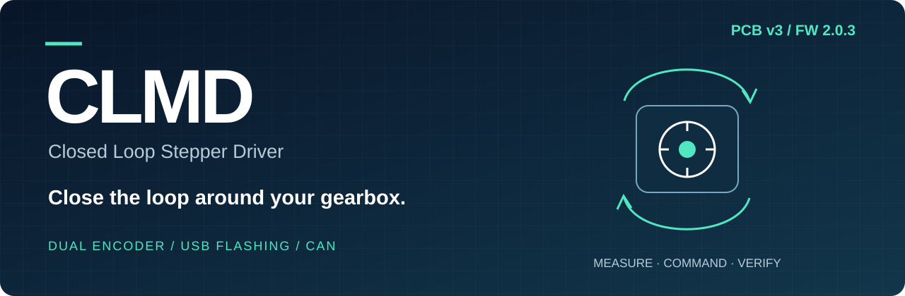
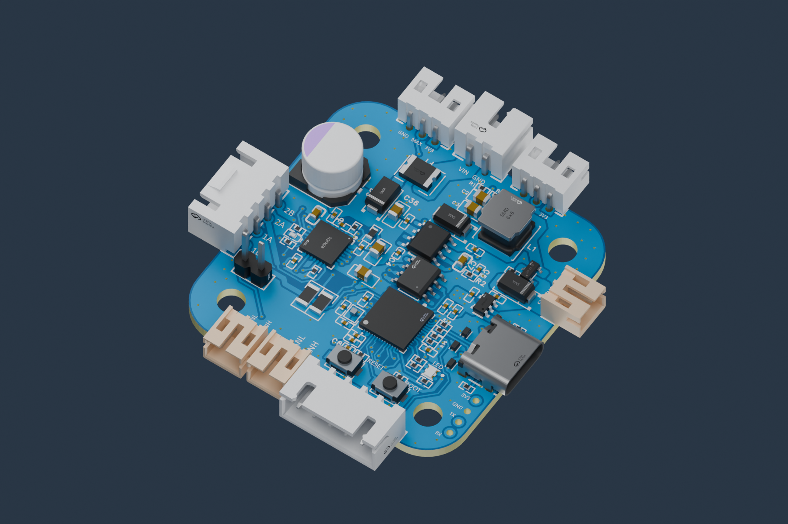
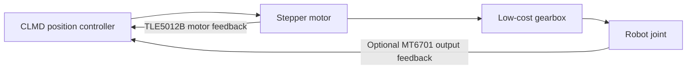
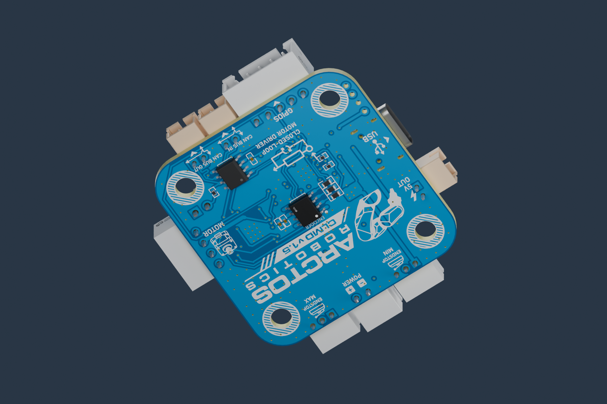
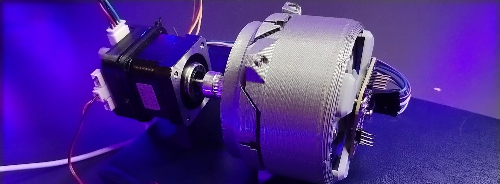
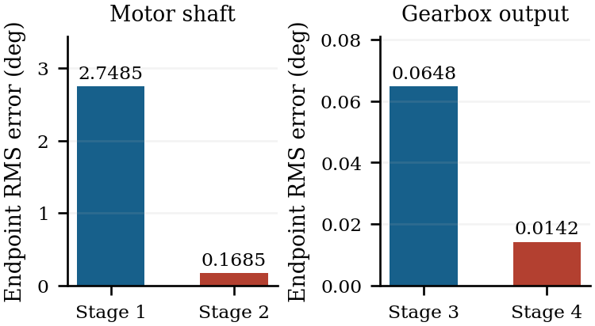

<p align="center">
  
</p>

<p align="center"><strong>$20 board · Up to 1.64 A RMS setting · Native USB · CAN · Optional gearbox-output feedback</strong></p>
<p align="center">
  <a href="docs/QUICK_START.md">Get started</a> · <a href="docs/FEATURES.md">Features & specifications</a> ·
  <a href="docs/FLASHING.md">Flash from Studio</a> · <a href="docs/ORDERING.md">Order / build a board</a>
</p>

# Close the loop around your gearbox.

**CLMD 1.5 is a $20 open-source closed-loop stepper driver built for affordable robotics.** It combines an ESP32-S3, TMC2209 power stage, motor-shaft encoder, native USB and CAN—and adds the option that matters for a geared robot: **a second encoder measuring the actual joint output.**

A motor can reach its target while gearbox play leaves the joint behind. CLMD can measure that difference and command the extra motor travel needed to take up backlash. That gives low-cost geared mechanisms a practical route to better output positioning.

Plug in USB to configure or flash the board. Use Arctos Studio's **Flash firmware over USB** button without an FTDI adapter, separate programmer or ESP-IDF installation. Connect multiple drivers along a **four-wire power-and-CAN backbone** and keep the wiring manageable as your robot grows.

<p align="center">
  
  <br><sub>New render from the included October PCB v3 STEP model. <a href="hardware/pcb-v3/">Design and manufacturing files</a> · <a href="assets/README.md">Image provenance</a>.</sub>
</p>

<p align="center"><strong>Current hardware: PCB v3 · Stable firmware: 2.0.3 · Product: CLMD 1.5</strong></p>

## What you get—and why it matters

| Feature | CLMD offers | Benefit for your build |
| --- | --- | --- |
| **Affordable driver** | **$20 board price**, supplied by the maintainer | Put feedback on more axes without making the driver the expensive part |
| **Secondary encoder** | Optional MT6701 feedback at the gearbox output | Measure the joint itself and actively compensate backlash-related position error |
| **Motor feedback** | TLE5012B magnetic encoder with 15-bit absolute angle data and checked SSC reads | Fine motor feedback with CRC and plausibility checks |
| **Native USB-C flashing** | ESP32-S3 USB bootloader; no FTDI/programming adapter | One USB cable for setup, diagnostics and firmware installation |
| **Studio flash button** | Integrated package verification, full backup, programming and readback | Flash from the same interface used to configure and test the driver |
| **TMC2209 drive stage** | SpreadCycle, 256 subdivision, programmable run/hold current; chip supports StealthChop2/CoolStep | A capable driver platform with room for firmware experimentation |
| **Up to 1.64 A RMS setting** | 50–1641 mA requests with the fitted 0.12 Ω sense resistors | Match current to your motor; read back saved and nominal applied settings |
| **Four-wire machine backbone** | VIN, GND, CANH and CANL; 500 kbit/s | Share power and communications between axes; motor/sensor leads stay local |
| **Protection built in** | Input reverse-polarity diode, resettable fuse, USB ESD devices, driver short/thermal protection | Several layers of electrical protection alongside firmware fault handling |
| **Easy commissioning** | USB/CAN jogs, speed tests, homing, current readback, encoder plots and CSV export | Configure and inspect the actual board from Arctos Studio |
| **Manufacturing files included** | Editable project, Gerbers, BOM, placement files and STEP model | Order assembly directly from a manufacturer or adapt the design |
| **Open-source hardware and firmware** | Editable hardware, C firmware and tests | Study, build, modify, contribute and sell under reciprocal open-source terms |

The $20 figure refers to the driver board and comes from the maintainer; confirm quantity, shipping/tax and optional-encoder pricing when ordering. [Ordering guide →](docs/ORDERING.md)

## The signature feature: feedback after the gearbox



| Configuration | What the controller sees | What it can do |
| --- | --- | --- |
| Motor encoder only | Motor-shaft motion | Correct motor position; gearbox play remains outside the measured loop |
| Motor + output encoder, **Monitor** | Motor travel and actual joint travel | Reveal reversal play and compare measured/ideal output travel |
| Motor + output encoder, **Control** | Actual joint position plus motor supervision | Move through gearbox play until the measured output reaches its target |

Output feedback can correct position error caused by gear clearance. Results depend on the mechanism, magnet, load and tuning. The [filmed 45:1 gearbox test](docs/bench/) includes the four recorded traces and measurement method. [Output encoder setup](docs/JOINT_ENCODER.md)

## Performance and specifications

| Parameter | Value | Meaning |
| --- | --- | --- |
| Maximum nominal current setting | **1.6415 A RMS** | Calculated full scale with fitted resistors; continuous rating depends on cooling |
| Run-current request range | **50–1641 mA** | Firmware 2.0.3; default request 1000 mA |
| Motor encoder absolute angle data | **15 bit / 32768 positions** | About 0.01099° sensor increment; not a calibrated accuracy claim |
| Command/position scale | **16384 counts per motor turn** | Protocol units; internal feedback can be fractional |
| Optional output encoder | **14 bit / 16384 positions** | About 0.02197° per output count, independent of gearbox ratio |
| Position-control task | **200 Hz nominal** | Motor loop; output acquisition nominally 100 Hz |
| Motor speed setting | **Up to 1200 RPM** | Firmware ceiling; achievable loaded speed depends on the motor/system |
| Acceleration setting | **50–600 RPM/s** | Default 400 RPM/s |
| Microstep subdivision | **256** | Released SpreadCycle configuration |
| CAN | **500 kbit/s, IDs 1–127** | Studio robot axes use 1–6; bus loading and supply capacity set practical scale |
| Output settling tolerance | **0.1° default, configurable** | Control setting, not guaranteed output accuracy |
| Physical USB / CAN jog checks | **+5° / −5° at 30 RPM** | Both verified in the 2.0.3 panel; see measured feedback results below |

The TLE5012B provides 15-bit angle data and 16-bit sine/cosine values. We use the manufacturer's distinction rather than calling it a 16-bit absolute-angle encoder. [Resolution comparison, current calculation, TMC features and protection details →](docs/FEATURES.md)

## TMC2209 capabilities

| Technology | Purpose | Released CLMD configuration |
| --- | --- | --- |
| **SpreadCycle** | Dynamic chopper current regulation | Enabled |
| **StealthChop2** | Quiet motor operation | Available in the chip; not enabled in this firmware |
| **CoolStep** | Load-adaptive current reduction | Available in the chip; not enabled in this firmware |
| **StallGuard4** | Sensorless load/stall feedback for StealthChop | Chip capability; CLMD currently uses encoder-based motion supervision |
| **256 subdivision / internal pulse generator** | Fine stepping and velocity generation | Used by CLMD |
| **Run/hold current + diagnostics** | Set torque/holding current; inspect faults | Configured and read back by the tools |

This table describes the actual release alongside the hardware's expansion potential. [TMC2209 manufacturer reference](https://www.analog.com/en/products/tmc2209.html).

## From a new board to your first move

1. **Order or assemble:** use the matching [fabrication files](hardware/README.md) and [ordering guide](docs/ORDERING.md).
2. **Connect USB:** no separate programmer is needed. Leave motor power off during first flashing.
3. **Flash in Studio:** open **Settings → CLMD Settings → Firmware**, choose the board port and installation mode, then click **Flash firmware over USB**. [Full guide](docs/FLASHING.md).
4. **Configure:** disable the drive, set current, node ID, polarity and limits, then read back the saved values.
5. **Test:** connect motor power and use a small Studio USB or CAN jog. Add the output encoder in Monitor before commissioning Control.

Firmware 2.0.3 can enable stationary hold at startup after health checks. Set `startup_enabled=0` if disabled startup is required; no move or home is issued at boot. [Quick start](docs/QUICK_START.md) · [Wiring](docs/WIRING.md) · [User guide](docs/USAGE.md).

## Results you can inspect

| Check | Recorded result | Evidence |
| --- | --- | --- |
| Studio USB firmware installation | Full 2 MB backup, app programming and explicit readback passed | [Flash record](docs/verification/gui-flash-verification.json) |
| Direct board-USB jog | +5° motor move at 30 RPM; final encoder-target error +0.219727° | [USB record](docs/verification/usb-motion-verification.json) |
| Physical CANable jog | −5° motor move at 30 RPM; final encoder-target error −0.197754° | [CAN record](docs/verification/can-motion-verification.json) |
| Dual-encoder position loop | PASS: simulated 24:1 gearbox, backlash and reversals | [Joint test log](docs/verification/joint.log) |
| Filmed gearbox test | Measured settled output error fell from 0.065° to 0.014° RMS on the 45:1 bench setup | [Method and traces](docs/bench/) |

Jog errors use the board's own encoder and are not independent loaded accuracy measurements. [Detailed performance evidence and benchmark procedure →](docs/PERFORMANCE.md)

## Hardware and bench gallery

<p align="center">
  
  <br><sub>Rear view of the current PCB v3 model, including the motor-shaft encoder.</sub>
</p>

<p align="center">
  
  <br><sub>The filmed 45:1 printed gearbox experiment. <a href="docs/bench/">Method, settings and raw CSVs</a>.</sub>
</p>



Output endpoint RMS error decreased by **78%**, from **0.0648° to 0.0142°**, between stages 3 and 4 of this run. These are encoder-referenced settled measurements, with six endpoints per stage; they do not establish independently calibrated absolute accuracy. The diagnostic bench build is separate from the stable download.

## Documentation

| I want to… | Guide |
| --- | --- |
| Compare features, resolution and protection | [Features & specifications](docs/FEATURES.md) |
| Order assembled boards / modify the design | [Ordering](docs/ORDERING.md), [hardware files](hardware/README.md) |
| Set up, wire and flash | [Quick start](docs/QUICK_START.md), [wiring](docs/WIRING.md), [flashing](docs/FLASHING.md) |
| Configure and test from Studio | [User guide](docs/USAGE.md), [Studio panel reference](docs/CLMD_SETTINGS.md) |
| Add backlash compensation | [Output encoder guide](docs/JOINT_ENCODER.md) |
| Integrate my own controller | [USB/CAN protocol](docs/PROTOCOL.md) |
| Inspect results / troubleshoot | [Performance](docs/PERFORMANCE.md), [fault guide](docs/TROUBLESHOOTING.md), [FAQ](docs/FAQ.md) |
| Build firmware / contribute | [Build guide](docs/BUILD.md), [contributing](CONTRIBUTING.md) |

## A focused hardware and firmware repository

```text
hardware/       Board sources, fabrication/assembly exports and mechanical model
firmware/       C source, C tests, build configuration, SDK patch and release images
assets/         Product visuals and Studio screenshots
docs/           User guides, specifications and verification records
```

All setup, flashing and interactive testing happen in **Arctos Studio**. Studio's application files and testing GUI are distributed with Studio, not this board repository.

The firmware download uses the `firmware-v2.0.3` release tag. The [stable update manifest](firmware/latest.json) records the asset name and checksum for Studio integration. [Update contract](docs/FIRMWARE_UPDATES.md)

## Open hardware. Open firmware. Contributions welcome.

Hardware uses **CERN-OHL-S-2.0**; firmware and project docs use **GPL-3.0-or-later**. Personal and commercial use are allowed. Distributing covered derivatives carries the applicable source-sharing, attribution and reciprocal-license requirements. [Licensing details](LICENSING.md).

Build your own boards, adapt the firmware, and contribute results that help affordable robotics. Gearbox measurements, integrations, hardware variants and clearer tutorials are welcome. [Contribute →](CONTRIBUTING.md)
