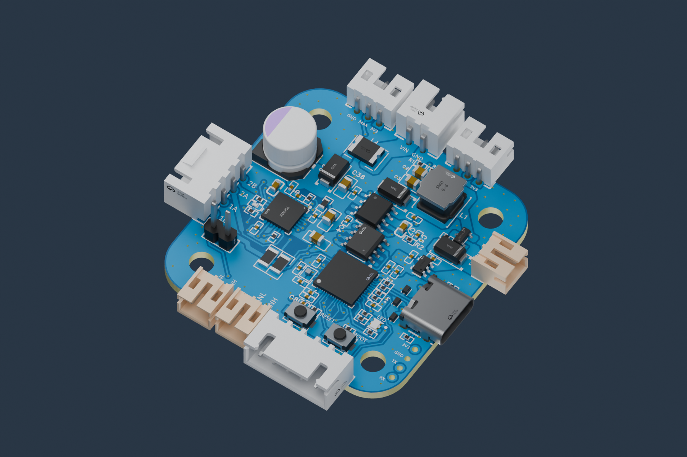
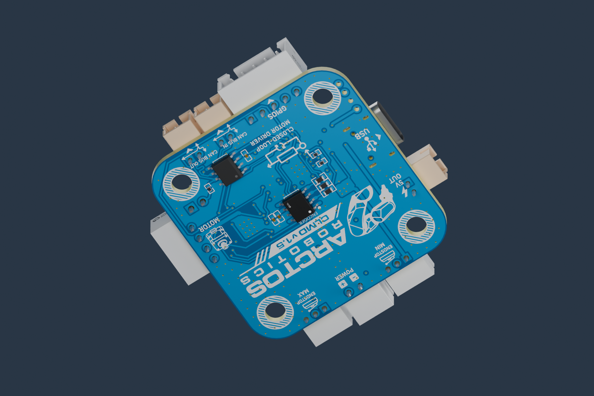

# Wiring and connectors

The connector numbers below come from the September schematic. The October PCB v3 archive includes the same schematic page records apart from editor metadata. The CAD renders below are generated from the October PCB v3 STEP model. Use the matching editable project to check physical connector placement, silkscreen and pin numbers. A front/back view can mirror apparent left-to-right order. Follow the pin numbers and verify continuity if orientation is uncertain. See the [version record](VERSIONS.md) for firmware details.



## Power

**USB supplies logic and encoder diagnostics. A separate motor supply is required for drive operation.** Start with a current-limited 12 V bench supply where compatible with your board and motor; the existing bench documentation uses 12 V. The exported schematic labels the motor rail `+24V`. A validated board-wide minimum/maximum voltage, continuous phase-current rating, and thermal envelope are not provided by the current release evidence. Component absolute maxima are not a board operating rating.

| Connection | Pin / net | Purpose |
| --- | --- | --- |
| U2 motor supply | Pin 1 GND; pin 2 VIN / +24V schematic net | Separate motor power |
| USB-C | USB data + VBUS | Configuration, updates, logic power |
| U17 | Pin 1 +5 V; pin 2 GND | Auxiliary 5 V rail; not motor VIN |
| U19 | Pin 1 +3.3 V; pin 2 GND | Expansion logic supply |

Power off before connecting/disconnecting the motor or moving wiring. Match polarity before applying power. ESP32 GPIO signals are 3.3 V; do not apply 5 V to an input. The schematic's section called an “isolator circuit” selects power rails; it does not establish galvanic isolation for USB or CAN.

## Motor

U16 carries the two motor phases:

| Pin | Board label |
| --- | --- |
| 1 | 2B |
| 2 | 2A |
| 3 | 1A |
| 4 | 1B |

With the motor disconnected, use an ohmmeter to identify each coil. One coil connects across 1A/1B, the other across 2A/2B. Wire colors are not standardized. For six/eight-wire motors, obtain the manufacturer's winding diagram and choose a supported bipolar connection.

The TLE5012B sensor is on the back of the board, facing the shaft magnet. Center the magnet and keep the board rigid relative to the motor. Verify a slow full turn and both directions before commanding motion. This firmware uses magnetic feedback; an unmagnetized assembly is not a complete closed-loop system.



## CAN

U8/U9 provide CANH and CANL on a common bus. Connect **H to H and L to L** according to your board silkscreen. The CAN pair connectors do not provide a ground pin; provide the adapter's reference ground through a documented board GND connection such as U19 pin 2. Use a linear twisted-pair bus with short stubs.

```text
120 Ω                                               120 Ω
Host adapter ===== CLMD node 1 ===== CLMD node 2 ===== CLMD node 3
                  intermediate boards: termination OFF
```

Close **U18** to add the board's 120-ohm termination. Enable termination at the two physical ends only. With power off, two 120-ohm end resistors in parallel give approximately 60 ohms across H/L. Unplug other circuits if they affect the resistance measurement.

All nodes and the host use **500 kbit/s**. Give each driver a unique node (1–127; Arctos Studio axes use 1–6). Configure one driver at a time over USB before joining a bus. A successful USB-injected CAN request validates the handler, not the physical bus. Confirm real replies in Studio with CAN selected.

For a robot-wide harness, carry **VIN, GND, CANH and CANL** along a four-wire backbone. Break out power and CAN to their separate board connectors at each axis. Motor and sensor wires remain local. Node count is bounded by addressing, bus loading/timing, cable layout and available supply current; it is not unlimited. See [four-wire integration](FEATURES.md#four-wires-across-the-robot).

## MIN / MAX inputs

| Connector | Pin 1 | Pin 2 | Pin 3 | ESP32 input |
| --- | --- | --- | --- | --- |
| CN1 MIN | +3.3 V | MIN signal | GND | GPIO15 / ADC2 channel 4 |
| CN2 MAX | +3.3 V | MAX signal | GND | GPIO16 / ADC2 channel 5 |

The firmware samples these as analog levels with configurable thresholds and hysteresis. Select sensors and signal conditioning that stay within the 3.3 V input range. A bare switch or different sensor needs its own threshold/connection validation; an open wire is not guaranteed to be detected.

For the tested KY-003 MIN sensor: no magnet was about 1737 ADC counts, magnet about 10. Threshold 874 and hysteresis 100 triggered at ≤774 and released at ≥974. These observations are specific to that assembly. MIN defaults enabled; MAX defaults disabled. Confirm both states repeatedly and the configured homing direction before motion.

## Optional MT6701 output encoder

U19 is the five-pin expansion connector:

| U19 pin | Net | Tested YYC-MT6701CT terminal |
| --- | --- | --- |
| 1 | +3.3 V | Module `5V` label **and MD**, both connected to 3.3 V |
| 2 | GND | GND |
| 3 | GPIO17 / SDA | SDA |
| 4 | GPIO18 / SCL | SCL |
| 5 | GPIO21 | Unused |

**MD is HIGH for the tested I²C setup.** The module was powered from 3.3 V despite its `5V` terminal label; other module revisions need their supply path and pull-ups checked. U17's +5 V pin is a different rail. Read the [complete joint encoder guide](JOINT_ENCODER.md) for magnet placement, addresses, alignment and modes. The external encoder is optional; the motor encoder remains required.

## On-board signals

For firmware modifications: TMC STEP/DIR/ENN GPIO6/7/8; UART TX/RX GPIO39/40; TLE SCK/CS/DATA GPIO12/10/13; CAN TX/RX GPIO5/4; RGB R/G/B GPIO11/9/14, active low. See [FIRMWARE.md](FIRMWARE.md#pin-assignments) and the original [schematic](../hardware/pcb-v2/Design%20Files/SCH_Schematic1_2026-09-22.pdf).
