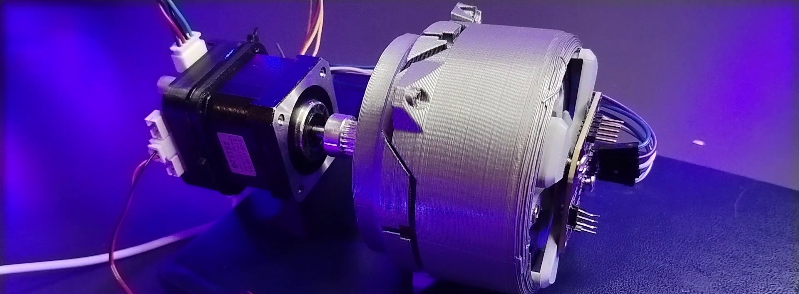
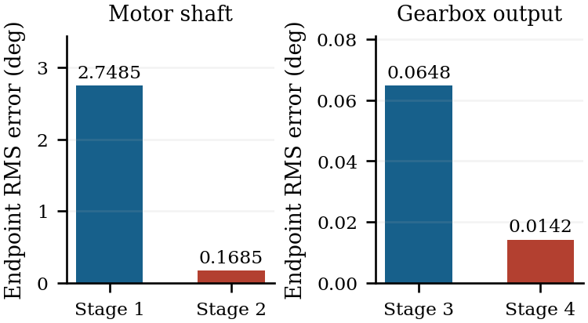
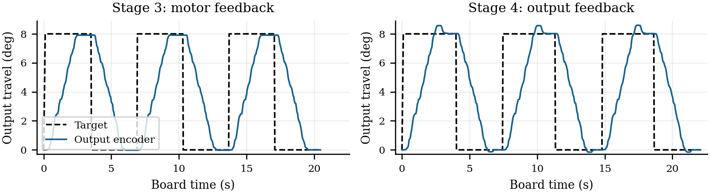

# Gearbox reversal test from the CLMD video

The bench used a 45:1 printed gearbox and ran three moves from 0° to 8° and back at a requested 30 motor RPM. Each RMS value uses six settled endpoints. Tests 1–2 report shaft error. Tests 3–4 report gearbox output error measured by the MT6701 at the joint.

| Test | Feedback used for correction | Reported settled RMS error |
| --- | --- | --- |
| [1. Open loop](test-1.csv) | None. The motor encoder records position. | 2.748° at the motor shaft |
| [2. Motor feedback](test-2.csv) | Motor encoder | 0.168° at the motor shaft |
| [3. Measure gearbox output](test-3.csv) | Motor encoder. The output encoder records position. | 0.065° at the gearbox output |
| [4. Close the loop at the output](test-4.csv) | Output encoder, with motor position feedback | 0.014° at the gearbox output |

The output RMS error fell by about 78% between tests 3 and 4. For each endpoint, take the median angle of the settle samples in the final 0.20 seconds of that leg, subtract the target, then take the RMS of the six endpoint errors. The [run summary](summary.json) includes the settings and unrounded results. For the open-loop shaft result, the reference is the last step-command angle in each leg.

The output encoder has 0.02197° per count. RMS across endpoints can be smaller than one count. These results describe the recorded encoder readings on this setup. Independent angle measurements would be needed to establish absolute accuracy.

The experimenter identified the physical setup as a NEMA 17 17HS3401 motor, 12 V DC supply, CLMD 1.5 board and the 45:1 PLA compound planetary gearbox from Arctos v2 axis 4. Logged run/hold requests were 800/200 mA. The 1.5 board identifier is separate from the public product name and archived PCB export labels.

The traces were captured with a diagnostic build derived from 2.0.3. The [public 2.0.3 firmware](../../firmware/releases/2.0.3/) is the stable release for normal use.
